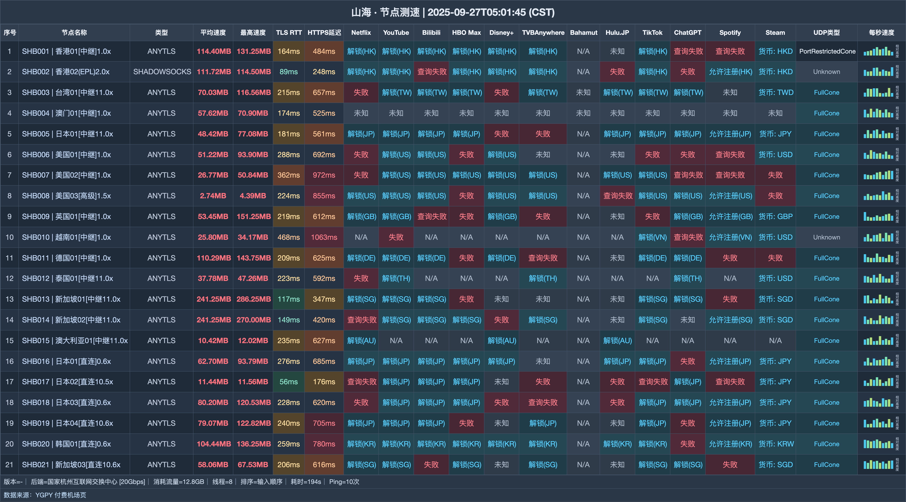

# 山海机场｜国内 128G 月付 15 元，海外 256G 月付 5 元（2026-10-31 更新）

> **一句话结论：国内入口与海外线路分开卖，六档套餐从一开始就把使用地点区分清楚**
>
> 👉 **[官网注册](https://shanhai.cfd/#/register?code=iyopi9RK)** · 人在国内先选 15 元迷你档；人在海外直接看 5 元国际小杯。

### 适合这三种选择逻辑：

- 国内月用量介于 128G—2048G
- 设备较多，希望设备数和速度都不限
- 人在海外，需要独立国际入口

### 下面两种买法容易选错：

- 海外用户购买通用套餐
- 电信晚高峰只依赖国际小杯

| 选购项 | 结论 |
|---|---|
| 国内入门 | 15 元/月，128G |
| 海外入门 | 5 元/月，256G |
| 设备数 | 不限 |
| 速度限制 | 不限 |
| 协议 | AnyTLS / Shadowsocks |
| 套餐分布 | 5 档通用 + 1 档国际 |

**认识一下这家机场**：山海（shanhai）把国内通用档和海外国际档拆开：前者从 15 元 128G 起，国际小杯则为 5 元 256G。

## 全部套餐怎么卖

| 套餐名称 | 费用 | 流量与周期 | 设备数 | 速度 | 购买须知 |
|---|---:|---:|---:|---:|---|
| 通用套餐-迷你 | ¥15/月付 | 128G / 每月 | 不限 | 不限 | 国内入口，海外客户请勿购买 |
| 通用套餐-入门 | ¥25/月付 | 256G / 每月 | 不限 | 不限 | 国内入口，海外客户请勿购买 |
| 通用套餐-基础 | ¥45/月付 | 512G / 每月 | 不限 | 不限 | 国内入口，海外客户请勿购买 |
| 通用套餐-进阶 | ¥85/月付 | 1024G / 每月 | 不限 | 不限 | 国内入口，海外客户请勿购买 |
| 通用套餐-高级 | ¥165/月付 | 2048G / 每月 | 不限 | 不限 | 国内入口，海外客户请勿购买 |
| 国际套餐-小杯 | ¥5/月付 | 256G / 每月 | 不限 | 不限 | Amazon 5Gbps全球骨干网，国际线路晚高峰电信可能不佳 |

> 五档通用套餐只面向国内入口；国际小杯使用 Amazon 5Gbps 全球骨干网，电信晚高峰可能不佳。重置包不延长时间，续购只延长时间。

## 节点测速一览

测试收录 **21 个节点**，内容覆盖下载与延迟；测试端为 **国家杭州互联网交换中心 [20Gbps]**，逐行结果放在下图。

## 先按所在地分流

1. 国内轻度用量从 15 元 128G 起步，增长后再换 25 元 256G。
2. 月用量达到 512G 时看 45 元基础档；设备不限不等于允许转售订阅。
3. 海外用户只选 5 元国际小杯，不要误购国内入口的通用档。

## 从这里注册

👉 **[官网注册](https://shanhai.cfd/#/register?code=iyopi9RK)** · 人在国内先选 15 元迷你档；人在海外直接看 5 元国际小杯。

*本文含推广链接；通过本文入口注册或购买，本站可能获得佣金。*

## 本文更新记录

- **2026-10-31** — 核对 6 个套餐/展示项，完成价量与限制整理。
- **2025-09-27** — 生成 B 版节点测速图，共 21 行。

---
*套餐、节点和活动可能调整，最终以购买页为准。*

展开相关搜索词

相关关键词：山海、shanhai、山海机场、山海vpn、机场推荐、机场测评、机场推荐2026、科学上网、代理、VPN、clash 订阅、山海官网、山海注册、山海测速

